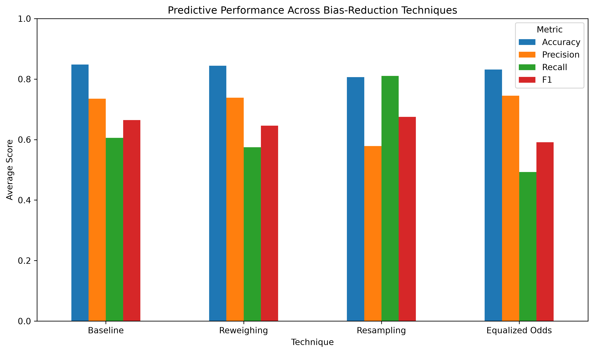
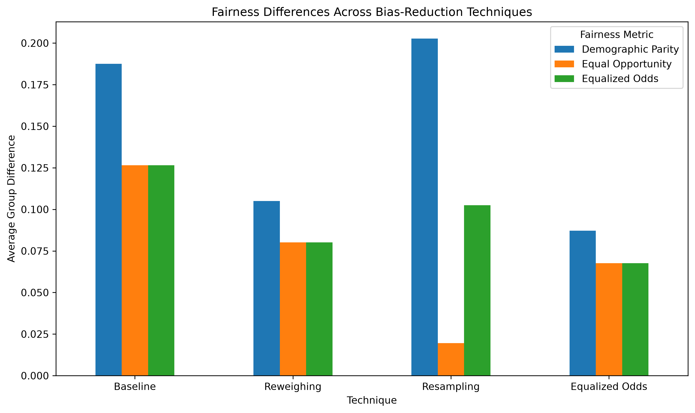
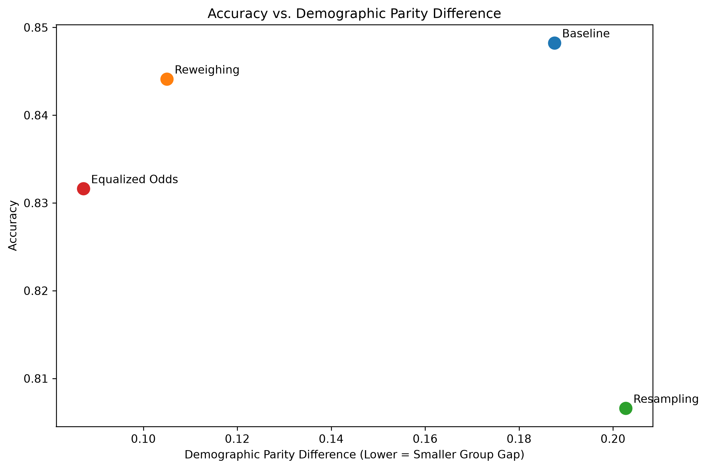
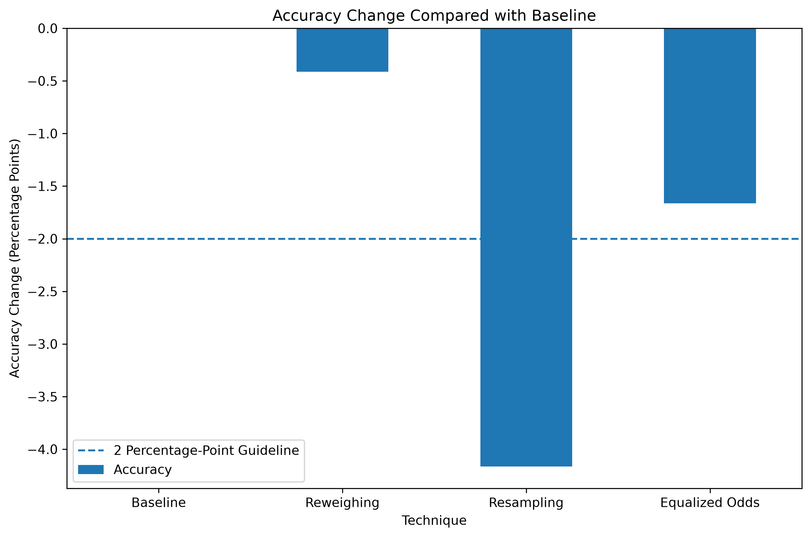

# Evaluating Bias-Reduction Techniques for Machine Learning Fairness

## Overview

This project evaluates whether bias-reduction techniques can improve fairness in a machine-learning classification model without substantially reducing predictive accuracy.

The experiment uses the **UCI Adult Income Dataset** and compares three bias-mitigation techniques against a baseline logistic regression model:

1. Reweighing
2. Resampling
3. Equalized Odds Post-processing

The experiment is repeated using three random seeds to evaluate whether the results remain consistent across different train, validation, and test splits.

---

## Research Questions

This study investigates the following questions:

1. What differences in predictive performance and fairness are observed in the baseline machine-learning model?

2. Which of the selected bias-reduction techniques is most effective at improving fairness?

3. How do bias-reduction techniques affect the relationship between fairness and predictive performance?

---

## Dataset

The project uses the **UCI Adult Income Dataset**.

The target variable predicts whether an individual's annual income is:

- `<= $50,000`
- `> $50,000`

The sensitive attribute used for fairness evaluation is:

- **Sex**

Sex is retained separately for fairness evaluation but is excluded from the predictor variables used to train the logistic regression model.

After rows containing missing values are removed, the experiment uses approximately 45,000 records.

---

## Machine-Learning Model

The classification algorithm used throughout the study is:

- **Logistic Regression**

Using the same classifier for all experimental conditions allows the effects of the bias-reduction techniques to be compared under consistent conditions.

---

## Bias-Reduction Techniques

### Reweighing

Reweighing changes how much influence individual training examples have during model training.

Examples from underrepresented sex/income combinations receive larger weights, while examples from overrepresented combinations may receive smaller weights.

The original training records and class labels are not changed.

### Resampling

Resampling changes the representation of different groups in the training dataset.

The experiment balances the following four sex/income combinations through oversampling:

- Female / `<= $50K`
- Female / `> $50K`
- Male / `<= $50K`
- Male / `> $50K`

Each combination is oversampled to match the size of the largest group.

### Equalized Odds Post-processing

Equalized odds is applied after the baseline logistic regression model has been trained.

Fairlearn's `ThresholdOptimizer` adjusts prediction thresholds across demographic groups to reduce differences in:

- True positive rates
- False positive rates

Validation data is used to determine the post-processing thresholds so that the final test data remains untouched until evaluation.

---

## Experimental Design

The dataset is divided into:

- **60% training**
- **20% validation**
- **20% testing**

The split is stratified using both the income class and sensitive attribute so that the demographic and target distributions remain similar across partitions.

The full experiment is repeated using:

- Seed 42
- Seed 43
- Seed 44

Each seed evaluates four experimental conditions:

1. Baseline
2. Reweighing
3. Resampling
4. Equalized Odds

This produces a total of:

**3 seeds × 4 conditions = 12 experiment results**

---

## Predictive Performance Metrics

The models are evaluated using:

### Accuracy
The percentage of all predictions that are correct.

### Precision
The percentage of positive predictions that are actually positive.

### Recall
The percentage of actual positive cases that the model correctly identifies.

### F1-score
A combined measure that balances precision and recall.

---

## Fairness Metrics

### Demographic Parity Difference

Measures the difference in positive prediction rates between demographic groups.

Values closer to **0** indicate a smaller group difference.

### Equal Opportunity Difference

Measures the difference in true positive rates between demographic groups.

Values closer to **0** indicate a smaller group difference.

### Equalized Odds Difference

Measures differences in true positive and false positive rates between demographic groups.

Values closer to **0** indicate a smaller group difference.

---

## Project Structure

```text
ai_fairness_thesis/
│
├── graphs/
│   ├── predictive_performance.png
│   ├── fairness_comparison.png
│   ├── accuracy_fairness_tradeoff.png
│   └── accuracy_change.png
│
├── results/
│   ├── all_seed_results.csv
│   └── summary_results.csv
│
├── data_setup.py
├── experiment.py
├── graphs.py
├── requirements.txt
├── README.md
└── .gitignore
```

---

## Installation

Clone the repository and open the project directory.

Create a Python virtual environment:

```bash
python -m venv .venv
```

Activate the environment on Windows:

```bash
.venv\Scripts\activate
```

Install the required packages:

```bash
pip install -r requirements.txt
```

---

## Running the Experiment

Run:

```bash
python experiment.py
```

The experiment will:

1. Download the Adult Income Dataset.
2. Clean and prepare the data.
3. Create training, validation, and testing partitions.
4. Train the baseline logistic regression model.
5. Evaluate reweighing.
6. Evaluate resampling.
7. Evaluate equalized odds post-processing.
8. Repeat the full experiment for seeds 42, 43, and 44.
9. Calculate average results and standard deviations.
10. Save the experiment results as CSV files.

The generated result files are:

```text
results/all_seed_results.csv
results/summary_results.csv
```

---

## Generating Graphs

After completing the experiment, run:

```bash
python graphs.py
```

This generates:

```text
graphs/predictive_performance.png
graphs/fairness_comparison.png
graphs/accuracy_fairness_tradeoff.png
graphs/accuracy_change.png
```

---

## Results

Average performance across seeds 42, 43, and 44:

| Technique | Accuracy | Precision | Recall | F1 Score | DP Difference | Equal Opportunity Difference | Equalized Odds Difference |
|---|---:|---:|---:|---:|---:|---:|---:|
| Baseline | 0.8482 | 0.7355 | 0.6057 | 0.6642 | 0.1875 | 0.1266 | 0.1266 |
| Reweighing | 0.8441 | 0.7388 | 0.5745 | 0.6462 | 0.1050 | 0.0802 | 0.0802 |
| Resampling | 0.8066 | 0.5784 | 0.8107 | 0.6751 | 0.2027 | 0.0195 | 0.1025 |
| Equalized Odds | 0.8316 | 0.7449 | 0.4926 | 0.5912 | 0.0872 | 0.0676 | 0.0676 |

---

## Key Findings

The experiment showed that each bias-reduction technique produced a different fairness-performance tradeoff.

**Reweighing** provided the strongest overall balance between fairness and predictive accuracy. It reduced demographic disparity while decreasing average accuracy by less than one percentage point compared with the baseline model.

**Resampling** achieved the lowest equal opportunity difference and the highest recall. However, it also caused the largest reduction in accuracy and precision and did not improve demographic parity.

**Equalized Odds Post-processing** produced the lowest demographic parity difference and equalized odds difference. Accuracy remained within approximately two percentage points of the baseline model, although recall and F1-score decreased.

These results suggest that no single bias-reduction technique is optimal for every objective. The most appropriate technique depends on which fairness measure and predictive-performance goal are prioritized.

---

## Visualizations

### Predictive Performance



### Fairness Comparison



### Accuracy vs. Fairness Tradeoff



### Accuracy Change Compared with Baseline



---

## Reproducibility

The experiment uses fixed random seeds:

```text
42
43
44
```

This allows the experiment to be repeated under the same data-splitting conditions.

The preprocessing pipeline is fitted using training data only.

The validation dataset is used for equalized odds threshold optimization.

The final testing dataset is kept separate until evaluation to reduce the risk of data leakage.

---

## Technologies

- Python
- Pandas
- NumPy
- Scikit-learn
- Fairlearn
- Matplotlib
- UCI Machine Learning Repository
- Visual Studio Code

---

## Limitations

This experiment uses the Adult Income Dataset, which is based on historical U.S. Census data and may not reflect current demographic or economic conditions.

The study evaluates only one primary sensitive attribute, one classification algorithm, and three bias-reduction techniques.

Fairness is evaluated using selected group fairness metrics and does not represent every possible definition of fairness.

The results therefore demonstrate how these techniques behave under the conditions of this experiment rather than establishing that one method is universally best.

---

## References

Becker, B., & Kohavi, R. (1996). *Adult* [Data set]. UCI Machine Learning Repository. https://doi.org/10.24432/C5XW20

Dutta, S., Wei, D., Yueksel, H., Chen, P.-Y., Liu, S., & Varshney, K. R. (2020). Is there a trade-off between fairness and accuracy? A perspective using mismatched hypothesis testing. *Proceedings of Machine Learning Research, 119*, 2803–2813.

Hardt, M., Price, E., & Srebro, N. (2016). Equality of opportunity in supervised learning. *Advances in Neural Information Processing Systems, 29*.

Kamiran, F., & Calders, T. (2012). Data preprocessing techniques for classification without discrimination. *Knowledge and Information Systems, 33*(1), 1–33. https://doi.org/10.1007/s10115-011-0463-8